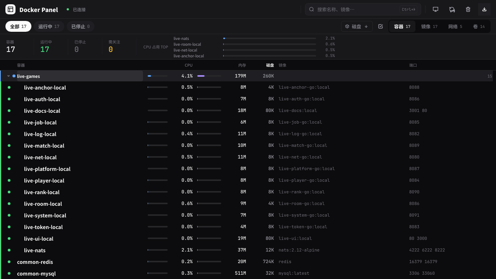
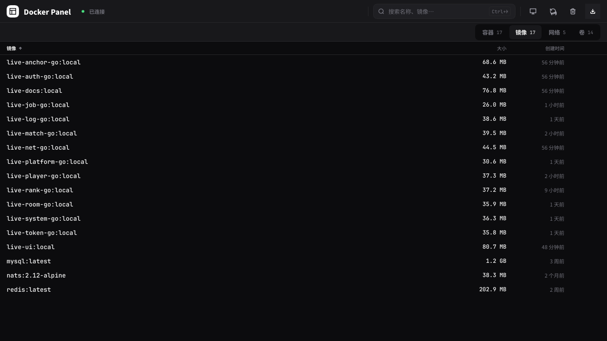
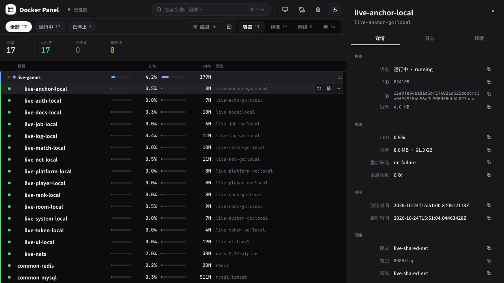
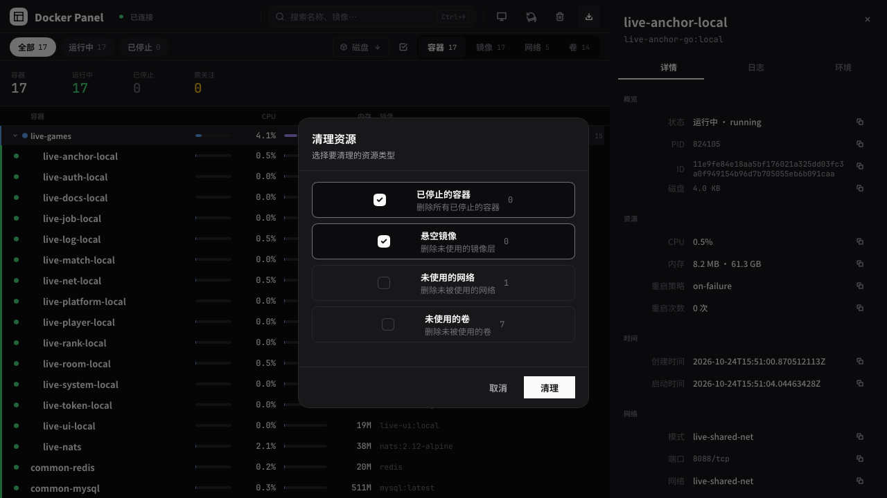

# Docker Panel

极简 Docker Engine 桌面管理面板。Rust 单二进制、Slint 原生 GUI、**纯软件渲染器**——零 GPU 依赖、零 Electron / Node 运行时。

[](https://github.com/pengtang1024/docker-panel/releases/latest)
[](LICENSE)
[](#环境要求)
<a href="https://slint.dev"></a>

文档导航：[Wiki](https://github.com/pengtang1024/docker-panel/wiki) · [架构设计](docs/architecture.md) · [规则配置层](docs/agents-rules.md) · [Git Flow 规范](docs/git-flow.md) · [AGENTS.md](AGENTS.md)（AI 协作入口）· [更新日志](CHANGELOG.md)

## 界面预览

| 容器台账（内联 Compose 树） | 镜像表格列表 |
|:---:|:---:|
|  |  |
| **右侧抽屉（详情 / 日志 / 环境）** | **清理弹窗** |
|  |  |

> 截图来自 Linux + Wayland + 深色主题，使用 Slint MCP 直接抓取窗口，未做后期合成。

## 功能特性

### 统一列表布局（无侧栏）

- 四个视图（容器 / 镜像 / 网络 / 卷）**全部是列表**：没有左侧栏，没有卡片网格
- 容器视图是**密集台账**：概览带（总数 / 运行中 / 已停止 / 需关注 + CPU 占用 TOP4）→ 表头 → 30px 虚拟化台账行
- 台账列：状态点、容器名、CPU（微条 + %）、内存（微条 + 容量）、磁盘、镜像、端口、行内操作
- 列起点严格固定（表头与每一行逐列同 x 同宽），CPU / 内存微条采用 **docker stats 口径**（CPU = 相对单核百分比 / 100，内存 = 用量 / 上限），同列同量纲可比
- 表头可点击排序（容器名 / CPU / 内存 / 磁盘），排序菜单另支持按状态排序；列宽随窗口响应式收缩（窄窗自动隐去磁盘 / 端口列）
- 「需关注」= 死亡 / 暂停 / 重启中 / 正在移除 / 异常退出（退出码 ≠ 0），行首琥珀色状态轨标记
- 镜像 / 网络 / 卷是**表格列表**（精简列 + 表头可点排序）：镜像 = `repo:tag` · 大小 · 创建时间；网络 = 名称 · driver · 子网；卷 = 名称 · 大小 · 挂载点
- 三个资源列表的排序**各自独立**（切视图回来保留）并持久化；排序方向在表头用 ↑/↓ 标出
- 筛选栏一键切换视图（Ctrl+1~4）；状态 chips / 排序菜单 / 多选按钮**只在容器视图出现**

### 台账内联 Compose 树

- 台账内部按 Compose 层级分组：**项目带 → 服务带 → 容器行**（1~2 级，只有多容器服务才出现服务带）
- 点箭头或点分组名 = 展开 / 收起（分组是**分组不是筛选器**）：排序字段只决定**组内**顺序，组间按组名稳定排
- 没有 Compose 归属的容器**直接在顶层**（不分「独立容器」组）
- 计数口径 = **可见容器集合**（实际渲染成行的那些容器）：概览带与筛选 chips 同源，折叠分组后计数同步变小
- 分组带通栏（不参与列宽计算），分组名与**同层**容器行的名称列起点严格对齐，层级只靠缩进表达
- 分组带显示该组的**资源汇总（成员之和）**：CPU / 内存 / 磁盘落在与容器行**同 x** 的三列上（CPU / 内存只算运行中成员，磁盘算全部成员；收起时数字照旧）
- 分组带与容器行一样有 **3 个操作按钮**（主操作 / 日志 / 更多），动作**统一作用于组内全部成员**：
  主按钮 = 全组启动（有成员没跑）/ 全组重启（全部在跑）；日志 = 组内运行中容器的**合并日志**
  （行首带 `[容器名]` 来源前缀，抽屉切到「只展示日志」模式）；更多 = 停止全部 / 重启全部 / 合并日志 / 删除全部
- 收起状态持久化到配置文件，启动自动恢复；新分组默认展开

### 右侧抽屉（详情 / 日志 / 环境）

- 点击容器台账行 → inspect 详情（概览 / 资源 / 时间 / 网络 / 配置五组）+ 实时日志流（虚拟化列表，滚动窗口 2000 行）+ 环境变量 Tab（环境变量 / 端口映射 / 网络 / 挂载）
- 点击镜像 / 网络 / 卷行 → 对应资源详情（单页，无 Tab）

### 操作

- 台账行内按钮：启停（▶/⏹）、重启（⟳）、日志（📜）、更多（···）；「···」菜单提供日志 / 停止 / 删除
- 分组带同样有 3 个按钮，只是按**组**操作：一键启停 / 重启整组、查看整组合并日志、删除整组（「···」菜单同样列出组操作）
- 容器多选 + 批量操作浮动栏（启动 / 停止 / 重启 / 删除 / 取消选择）；Shift+点击行可快速勾选 / 取消勾选
- 顶栏：拉取镜像（实时进度弹窗）/ 清理未使用资源（已停止的容器 / 悬空镜像 / 未使用的网络 / 未使用的卷，可任意组合）
- 操作完成立即刷新列表，不等 3s 定时周期

### 全局快捷键

- Ctrl+K 聚焦搜索、`/` 聚焦搜索、Ctrl+R 刷新、Ctrl+1~4 切换视图、Esc 关闭抽屉 / 弹窗 / 退出多选

### 主题与本地化

- 浅色 / 深色 / 跟随系统 三态主题，完整的浅 / 深双套色板（语义色 + 状态 / 微条 / 日志等辅助色）
- 内置 Material 3 组件库（`@material`，ScrollView / ListView）的色板由项目令牌映射而来，跟随应用主题而非系统主题
- 界面文案中英双语，跟随系统 locale 自动选择（zh* → zh_CN）

### 配置持久化

- 主题 / 视图 / 筛选 / 排序 / 搜索词 / 日志跟随 / 台账内联树的收起分组 / 三个资源列表各自的排序 持久化到用户配置目录，启动自动恢复

### 自动更新

- 启动 10s 后检查 GitHub Releases（24h 节流，可在设置页关闭）；顶栏「盒子」图标发现新版本时显示徽标点
- 更新弹窗展示当前 / 最新版本与 Release 更新说明（Markdown/HTML 已清洗为纯文本），支持一键下载、SHA-256 校验、安装
- 默认全自动：检测到新版本后自动下载安装，安装成功自动重启（可在设置页逐项关闭）
- deb 安装（`dpkg-query` 命中 `docker-panel`）走 `pkexec dpkg -i`；裸二进制安装走同目录临时文件 + `rename` 原子替换
- 开发构建 / 非 Linux / 无匹配资产 / 安装目录不可写时只展示原因并引导到下载页，不执行半途安装
- 「启动时检查更新」「自动下载并安装更新」「安装后自动重启」三个开关持久化到 `config.json`，默认开启

### 设置页

- 顶栏齿轮图标打开设置弹窗：外观（跟随系统 / 浅色 / 深色）+ 自动更新三个开关

### 连接状态

- 顶栏 Docker 连接角标：● 已连接 / ○ 未连接
- 底部栏 8 项资源概览 + 最近操作结果

## 环境要求

- Linux / macOS / Windows（主要在 Linux 上验证）
- 本机已安装并运行 Docker，默认通过 unix socket `/var/run/docker.sock` 连接；`DOCKER_HOST=unix://...` 可指定其它本机 socket（当前不读取 tcp / ssh 远程地址）
- 自动更新检查需要系统 `curl`（Linux / macOS / Windows 10+ 自带）；deb 自动安装还需要 `pkexec`（polkit 授权框）
- 构建需要 Rust stable（edition 2021）

## 安装与构建

### Debian / Ubuntu（deb 包）

从 [Releases](https://github.com/pengtang1024/docker-panel/releases) 下载 `docker-panel_<版本>_amd64.deb`：

```bash
sudo dpkg -i docker-panel_<版本>_amd64.deb
```

安装后在应用菜单中找到 Docker Panel；若点了没反应，多半是当前用户没有 Docker socket 权限：

```bash
sudo usermod -aG docker $USER
```

deb 安装的版本可直接在应用内更新：顶栏「盒子」图标 → 检查更新 → 立即更新，授权 `pkexec` 后会调用 `dpkg -i` 安装新包；裸二进制版本则在安装目录可写时自替换。

### 从源码构建

Linux 上 Slint software renderer 只依赖系统字体，不需要 libgl1：

```bash
# 调试运行
cargo run

# 发布构建（体积最小化 profile：opt-level=z + LTO + strip + panic=abort）
cargo build --release --locked
./target/release/docker-panel
```

### 开发与验证

```bash
cargo fmt --all -- --check
cargo clippy --all-targets --all-features -- -D warnings
cargo test
cargo check --all-targets
```

## 使用说明

1. 启动后默认显示容器台账视图，Docker 连接成功会自动加载。
2. Ctrl+K 聚焦搜索框，输入关键词即时过滤；Ctrl+R 手动刷新。
3. 容器台账行内按钮：▶/⏹ 切换状态、⟳ 重启、📜 查看日志、··· 更多操作；分组带上的同名按钮对组内全部容器生效（日志为整组合并流）。
4. 点击容器台账行 → 右侧抽屉显示详情 / 日志 / 环境；点击镜像 / 网络 / 卷行 → 对应资源详情。
5. Ctrl+1~4 切换 容器 / 镜像 / 网络 / 卷 视图；Esc 关闭抽屉 / 弹窗或退出多选。
6. 容器视图点分组带的箭头或分组名展开 / 收起 Compose 分组；分组带 hover 后出现启动 / 合并日志 / 组菜单；镜像 / 网络 / 卷点表头按列排序。
7. 顶栏按钮：切换主题 / 刷新 / 清理 / 检查更新 / 拉取镜像；发现新版本时更新图标带徽标点。
8. 底部栏显示 8 项资源概览（Docker / 容器 / 镜像 / 网络 / 卷 / CPU / 内存 / 磁盘）与最近操作结果。

## 已知限制

- 无 Docker Compose 导入 / 导出、无定时清理
- 镜像 / 网络 / 卷不支持多选批量；网络 / 卷当前没有行内删除入口
- 镜像行的 ▶（Run）按钮只回显提示，尚未接入真正的 `docker run`
- 断流窗口的日志不补回；日志窗口最多保留 2000 行（合并日志的多个成员共享这一个窗口）
- 容器停止后不自动重连日志流，需要重新切到日志 Tab；合并日志中某个成员停掉只会结束它自己那一路流
- `DOCKER_HOST` 仅识别 `unix://` 路径，不支持 tcp / ssh 远程连接
- 自动更新只支持 Linux 的 deb / 裸二进制安装；开发构建与其它平台只提示新版本并打开下载页
- 更新包没有代码签名，只依赖 HTTPS 与同一 Release 的 `checksums.txt`（SHA-256）校验
- 自动安装 deb 需要桌面 polkit 授权代理；无 polkit 的环境只能手动下载安装

## 架构概览

**三线程架构**：主线程（Slint 事件循环）+ consumer 线程（消息泵 + `invoke_from_event_loop`）+ tokio runtime（bollard async）。定时刷新走 tokio interval（软件渲染器下 Slint Timer 不触发）。

```
主线程 (ui.run() 阻塞)          consumer 线程                  tokio runtime (多线程)
┌──────────────────────┐       ┌────────────────────────┐       ┌───────────────────┐
│ UI 回调（搜索/排序/    │       │ recv_timeout(≤100ms) 循环 │       │ 3s 刷新 interval    │
│  操作/快捷键）──lock─▶│ 分批 drain（≤2048 条/批） │       │ 6s stats interval   │
│ 窗口关闭 → shutdown   │ 按 120ms 窗口合并 UI 更新  │       │ spawn 异步任务      │
│   flag                │ 只重建变化区域（日志/列表）│◀──────│ bollard API 调用    │
│                        │ drop(s) ──────────────────lock rel│ tx.send(Msg)        │
│                        │ invoke_from_event_loop     │       │ follow_logs 流      │
│                        │   render 缓存 + apply_drawer       │                     │
└──────────────────────┘       └────────────────────────┘       └───────────────────┘
     Mutex<AppState>                 mpsc::Receiver<Msg>          spawn(async { ... })
   + shutdown: AtomicBool            （consumer 独占，不进 Mutex）
```

**关键设计**：
- `Receiver<Msg>` 由 consumer 独占所有权，**不**放进 Mutex。这样 `rx.recv_timeout()` 永远不阻塞主线程拿 state 锁。
- **两阶段铁律**：锁内只做分片 drain（单批 ≤2048 条）+ build → drop lock → 锁外 `invoke_from_event_loop` 更新 Slint Model。闭包里绝不碰 state。
- **UI 更新节流**：consumer 最多每 120ms 应用一次 UI；日志洪峰时只**追加**日志行模型，不重算容器/镜像/网络/卷/抽屉，避免无界 invoke 与重排把 UI 线程压死。
- **日志行模型只追加不重建**：行模型是日志窗口的镜像（滚动窗口 2000 行），能追加就追加（可见行不重排 → 不卡），窗口裁剪过前段才整体重建一次。
- **Docker 调用有超时 + 刷新去重**：单次调用 10s 超时；上一次 3s 刷新未完成时跳过下一轮，防止守护进程无响应时任务叠加耗尽 tokio 线程。
- **所有 Docker 结果走 `tx.send(Msg)`**——不直接碰 Slint Model，统一由 consumer pump 更新。

详见 [docs/architecture.md](docs/architecture.md)。

## 项目结构

```
docker-panel/
├── Cargo.toml              # 依赖：slint 1.18.1 / bollard 0.21 / tokio / arboard / sha2 / futures
├── Cargo.lock
├── deny.toml               # cargo-deny 许可证门禁（宽松许可 + Slint RF 2.0 allow-list）
├── build.rs                # slint_build::compile_with_config + with_bundled_translations("translations")
│
├── ui/                     # Slint UI 声明（按职责拆分，app.slint 唯一组装入口）
│   ├── app.slint           # MainWindow：根级 global-shortcuts FocusScope（快捷键）+ 布局组装
│   ├── overlays.slint      # 窗口级浮层：排序菜单 / 卡片与分组菜单 / 拉取与清理弹窗 / 自动更新弹窗 / 全局 TipLayer
│   ├── main-area.slint     # 主列表工作区：SubBar + BatchBar + ListArea
│   ├── app-actions.slint   # AppActions global：UI → Rust 的唯一回调入口
│   ├── theme.slint         # 浅/深双套色板（31 个颜色令牌）+ 字号/间距，theme_mode 三态
│   ├── material-theme.slint # M3 色板映射：Theme.* → MaterialScheme（@material 的 ScrollView/ListView 跟随应用主题）
│   ├── models.slint        # ContainerRow / ImageRow / NetworkRow / VolumeRow / DetailPair / LogRow / LedgerSummary struct
│   ├── top-bar.slint       # TopBar：logo + 连接状态 + 搜索框(Ctrl+K) + 主题/设置/刷新/清理/更新/拉取按钮
│   ├── sub-bar.slint       # SubBar：状态筛选 chips + 排序 + 4 视图 tabs（chips/排序/多选仅容器视图）
│   ├── list-area.slint     # 资源列表区：容器视图走台账，镜像/网络/卷走表格列表（含空状态与背景点击层）
│   ├── ledger.slint        # 容器台账区：列宽计算 + 表头 + @material ListView 虚拟化台账行
│   ├── ledger-row.slint    # 台账行 delegate（30px）：状态轨 / 勾选框 / 微条 / 行内操作
│   ├── ledger-tree-row.slint # 台账内联树分组带 delegate（项目带 / 服务带：箭头 + 色点 + 计数 + 组内资源汇总 + 组操作按钮，通栏）
│   ├── ledger-band.slint   # 台账概览带：4 个计数 + CPU 占用 TOP4
│   ├── ledger-cols.slint   # 台账列宽契约 global（表头与行共用同一组列宽）
│   ├── image-list.slint    # 镜像表格列表：repo:tag · 大小 · 创建时间（表头可点排序）
│   ├── network-list.slint  # 网络表格列表：名称 · driver · 子网（表头可点排序）
│   ├── volume-list.slint   # 卷表格列表：名称 · 大小 · 挂载点（表头可点排序）
│   ├── components-list.slint # 列表共用基件：ListCols 列宽契约 + ListHeadCell 表头单元格
│   ├── skel.slint          # 骨架屏占位
│   ├── foot-bar.slint      # 底部 8 项资源概览
│   ├── batch-bar.slint     # 批量操作浮动栏（选中容器才显示）
│   ├── drawer.slint        # 右侧抽屉：详情/日志/环境 三 Tab（四种资源共用；合并日志时 log_only 只展示日志）
│   ├── drawer-detail-row.slint # 详情/环境行（kind 区分 kv / 代码盒 / 挂载 chip）
│   ├── drawer-log-row.slint # 日志行 delegate（虚拟化 ListView 的一行 = 一条日志）
│   ├── dialogs.slint       # PullDialog + CleanupDialog 弹窗
│   ├── update-dialog.slint # 自动更新弹窗（版本对比 / 更新说明 / 进度 / 两个开关 / 安装与重启）
│   ├── update-state.slint  # 自动更新 UI 状态 global（顶栏 / 弹窗 / Rust 共享）
│   ├── settings-dialog.slint # 设置弹窗（外观三选 + 自动更新三个开关）
│   ├── settings-state.slint # 设置弹窗开关 global
│   ├── menu-layers.slint   # 浮动菜单层：排序菜单 + 行「···」菜单（须在列表区之后渲染）
│   ├── components-*.slint  # 原子组件库按职能拆分：interact / nav / form / chip / align / state / empty / feedback / dialog
│
├── src/                    # Rust 层（所有 ≤ 300 行）
│   ├── main.rs             # 组装入口：i18n → AppState → MainWindow → consumer/bootstrap 启动 → ui.run() → 优雅退出
│   ├── slint_gen.rs        # slint::include_modules!() 集中入口
│   ├── i18n.rs             # locale 检测（zh*→zh_CN）+ Rust 侧 t()/trf()/trfp() + slint_language()
│   ├── config.rs           # AppConfig 持久化（directories + 手写 JSON 原子写）
│   ├── theme.rs            # 系统主题检测（gsettings / GTK settings.ini）
│   ├── consumer.rs         # consumer 线程：分批 drain + 120ms UI 节流 + 变化区域重建 + 3s 刷新 interval
│   ├── bootstrap.rs        # 6s stats 采样 interval + 首屏四列表加载 + inspect 首容器
│   ├── models.rs           # Msg(+StatsBatch/LogBatch/UpdateCheckDone/UpdateProgress/UpdateDone) / ContainerInfo / ImageInfo / ContainerDetail / ResourceSort 等
│   ├── models/update.rs    # 自动更新类型：UpdateInfo / InstallPlan / UnsupportedReason（models 层，避免反向依赖）
│   ├── ui_state.rs         # AppState + 四列表刷新（去重/超时）+ 日志流状态字段 + cleanup_counts + persist
│   ├── ui_state/follow_state.rs # 日志跟随状态机：单容器 / 分组合并日志的建流、Clear、幂等判定
│   ├── ui_state/log_sync.rs # 日志窗口裁剪 + UI 行模型同步账（LogSyncPlan：Append / Reset）
│   ├── ui_state/config_io.rs # AppState ↔ config.json 读写（字段搬运，越界值回落默认）
│   ├── follow_runtime.rs    # 日志流运行时：建流（单流 / 分组合并多流，共享取消信号）/退避重连/探针判定/保活降级/结局分类
│   ├── log_status.rs       # 日志流状态提示文案唯一定义处（3 条 i18n key）
│   ├── render.rs           # CachedModel 差量同步 + 日志行模型 Append/Reset 同步
│   ├── detail_fmt/         # 抽屉详情格式化：mod（公共 kv/head/format_bytes）+ container / image / netvol
│   ├── ui_rows/            # 行构建：mod（hit_any 搜索）+ containers（容器台账行）/ ledger（概览带）/ compose_tree（台账内联树行 + tests.rs）/ group_totals（分组资源汇总）/ images / netvol（网络/卷）
│   ├── ui_update.rs        # DrainResult + 有上限 drain_messages + Msg → 变化区域聚合（日志洪峰防护）
│   ├── ui_update/update.rs # 自动更新消息 → AppState / DrainResult（从 ui_update 拆出，满足 R2）
│   ├── ui_apply.rs         # apply_drawer / refresh_lists_now / clear_log_panel / clear_log_status / status_toast
│   ├── batch.rs            # BatchState 多选状态
│   ├── callbacks.rs        # 回调绑定中枢 + restore_config
│   ├── callbacks_container.rs  # AppActions container_* 回调
│   ├── callbacks_drawer.rs     # 抽屉 Tab 切换（日志 Tab 触发 ensure_follow）+ 跟随/复制/清空
│   ├── callbacks_image.rs      # AppActions image_* 回调
│   ├── callbacks_netvol.rs     # 网络/卷 select / remove 回调
│   ├── callbacks_compose.rs    # 台账内联树回调（分组展开 / 收起 + 组操作：启动/停止/重启/删除/合并日志）
│   ├── callbacks_sort.rs       # 三个资源列表的表头排序回调（各自独立的状态 + 持久化）
│   ├── callbacks_update.rs     # 自动更新回调：检查 / 安装 / 打开下载页 / 重启 / 三个配置开关
│   ├── callbacks_settings.rs   # 设置弹窗：开关弹窗 / 显式设置主题（0=跟随系统 1=浅色 2=深色）
│   ├── update/                 # 自动更新：github（curl + JSON）/ version（纯逻辑 + 单测）/ markdown（Release 说明 → 纯文本）/ install（探测 + 安装）+ install/download（下载 + 校验）
│   └── docker/
│       ├── mod.rs          # connect() + with_timeout（10s 调用上限）+ pub use 重导出
│       ├── containers.rs   # list / start / stop / restart / remove
│       ├── images.rs       # list / pull（含进度闭包）/ remove
│       ├── logs.rs         # follow_logs（Stream → 行批 tx.send，含空闲超时 + 复用定时器）
│       ├── log_types.rs    # 日志流结束原因 / 错误分类 / 退避常量（纯类型，单测不依赖 Docker）
│       ├── stats.rs        # fetch_stats + compute_cpu_delta（双采样 CPU%）
│       ├── netvol.rs       # list_networks / list_volumes + volume_sizes（裸 HTTP 读 Volumes 键）
│       ├── raw_http.rs     # 裸 HTTP 请求（Unix socket + chunked 解码；bollard 未建模的接口）
│       ├── image_details.rs # inspect_image → ImageDetail
│       ├── container_detail.rs # inspect_container + probe_container（存活性探针）
│       └── system.rs       # cleanup prune
│
├── translations/
│   └── zh_CN/LC_MESSAGES/docker-panel.po   # gettext 翻译（编译期嵌入）
│
├── docs/
│   ├── architecture.md     # 架构总纲（技术栈 + 模块地图 + 文件规范 + 主题文档导航）
│   ├── arch/               # 架构主题文档：threading / ui-interaction / docker-bollard
│   ├── agents-rules.md     # 规则配置层（规则地图 + 红线约束 + 四阶段门禁 + 冲突记录）
│   └── git-flow.md         # Git Flow 分支与发版规范
├── packaging/
│   ├── debian/control
│   ├── debian/copyright    # DEP-5：自有 MIT + 第三方许可清单
│   ├── docker-panel.desktop
│   └── docker-panel.svg
├── material-1.1.0/         # Slint Material Components（第三方，MIT / SixtyFPS GmbH）
├── licenses/               # 第三方许可全文（Apache-2.0 / BSD / ISC / Zlib / Unicode / Slint RF）
├── LICENSE                 # 自有代码 MIT
├── LICENSING.md            # 许可选择记录（Slint Royalty-free 2.0）
├── THIRD-PARTY-NOTICES.md  # 第三方组件清单与许可索引
├── AGENTS.md               # AI 协作入口（首次进入仓库请先读）
├── CHANGELOG.md            # 更新日志
└── README.md
```

## 主要依赖（精确版本）

| crate | 精确版本 | Feature / 用途 |
|-------|----------|----------------|
| slint | **1.18.1** | `backend-winit` + `renderer-software` + `software-renderer-systemfonts` + `compat-1-18` + `std` |
| slint-build | **1.18.1** | build-dependency，`compile_with_config` + bundled translations |
| bollard | **0.21** | Docker Engine API 纯 async 客户端 |
| tokio | **1.x** | `rt-multi-thread` + `macros` + `time` + `sync` + `rt`（default-features=false） |
| futures | **0.3** | — |
| futures-util | **0.3** | 提供 `StreamExt`（`.next().await`） |
| serde_json | **1.x** | bollard 内部序列化 |
| anyhow | **1.x** | — |
| arboard | **3.x** | 剪贴板；Wayland 走 data-control 协议（无需外部 wl-copy） |
| sha2 | **0.10** | 自动更新包的 SHA-256 校验（HTTP 走系统 curl，不引入 TLS crate） |

> 完整技术栈精确版本和版本特有 API 限制见 `AGENTS.md`。

## 许可证

本项目**自有代码**以 MIT 发布，全文见 [LICENSE](LICENSE)。

发行物（二进制 / deb）还静态链接了第三方组件，各自保留原许可证：

- **Slint 1.18.1**：Slint Royalty-free 2.0（本项目选择的许可分支，署名见顶部 “Made with Slint” 徽章）
- **Slint Material Components 1.1.0**：MIT（SixtyFPS GmbH）
- 其余依赖：Apache-2.0 / BSD / ISC / Zlib / Unicode-3.0 等宽松许可

完整清单与许可全文见 [THIRD-PARTY-NOTICES.md](THIRD-PARTY-NOTICES.md)，许可选择记录见 [LICENSING.md](LICENSING.md)。
