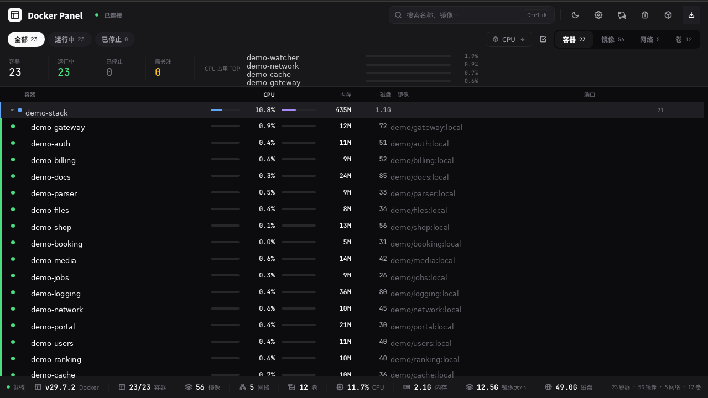
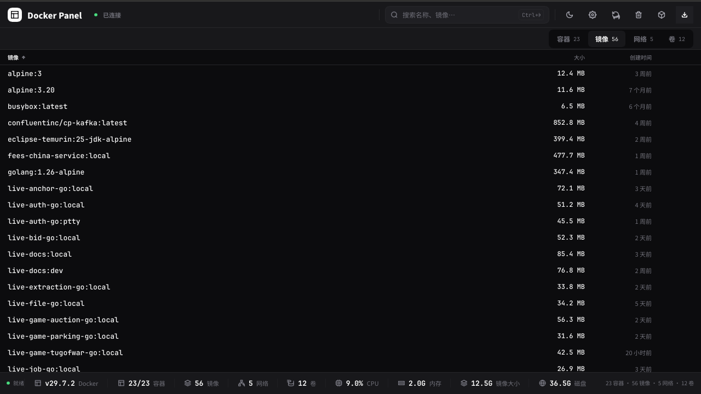
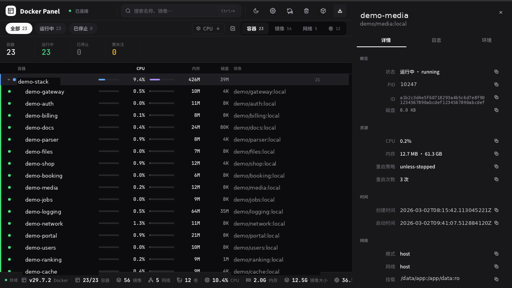
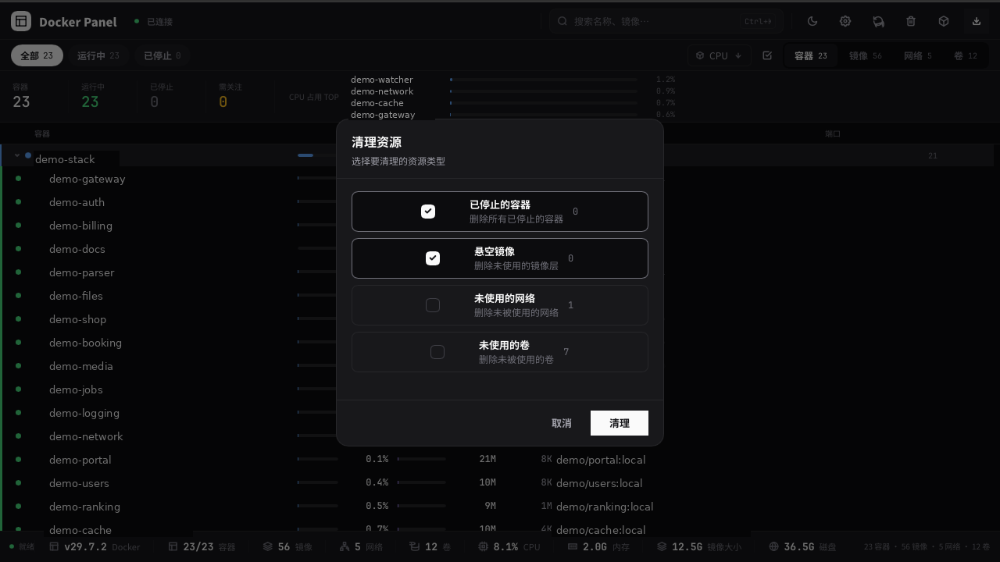

<div align="center">

# Docker Panel

**极简 Docker Engine 桌面管理面板**

Rust 单二进制 · Slint 原生 GUI · 纯软件渲染

<sub>零 GPU 依赖 · 零 Electron / Node 运行时 · 单个可执行文件即可运行</sub>

[](https://github.com/pengtang1024/docker-panel/releases/latest)
[](LICENSE)
[](#3-环境要求)
[](#3-环境要求)
<a href="https://slint.dev"></a>

</div>

> **一句话**：给「只想看看容器状态、启停一下、翻翻日志」的人用的 Docker 面板——启动即用，不装 Electron 运行时，不要求 GPU 驱动，单文件二进制约 5 MB。

> [!TIP]
> **30 秒上手**：从 [Releases](https://github.com/pengtang1024/docker-panel/releases) 下载 `.deb` → `sudo dpkg -i docker-panel_<版本>_amd64.deb` → 应用菜单打开 **Docker Panel**。点了没反应多半是没给 Docker socket 权限：`sudo usermod -aG docker $USER`（重新登录生效）。

## 目录

| # | 章节 | 你会在这里找到 |
|:--:|------|----------------|
| 1 | [界面预览](#1-界面预览) | 四个视图与抽屉的实拍截图 |
| 2 | [功能特性](#2-功能特性) | 台账布局、Compose 树、抽屉、操作、快捷键、主题、自动更新 |
| 3 | [环境要求](#3-环境要求) | 平台范围、Docker 连接方式、运行时依赖 |
| 4 | [安装与构建](#4-安装与构建) | deb 安装、源码构建、本地验证命令 |
| 5 | [使用说明](#5-使用说明) | 从启动到日常操作的 9 个步骤 |
| 6 | [已知限制](#6-已知限制) | **动手前请先看**：单实例、日志补回、更新签名等边界 |
| 7 | [架构概览](#7-架构概览) | 三线程模型与关键设计取舍 |
| 8 | [项目结构](#8-项目结构) | 逐目录逐文件的职责注释 |
| 9 | [主要依赖](#9-主要依赖精确版本) | 精确版本与版本特有的 API 约束 |
| 10 | [许可证](#10-许可证) | 自有 MIT 与第三方许可分布 |

## 1. 界面预览

| 容器台账（内联 Compose 树） | 镜像表格列表 |
|:---:|:---:|
|  |  |
| **右侧抽屉（详情 / 日志 / 环境）** | **清理弹窗** |
|  |  |

<sub>截图来自 Linux + Wayland + 深色主题，由 `agkit shot --app docker-panel` 按 xdg app_id 定位窗口截取（见 [AGENTS.md](AGENTS.md) R1），仅裁去窗口标题栏。**容器名、镜像名、分组名、容器 ID、PID、创建/启动时间与挂载路径已替换为中性示例值**（`demo-*`），版面、列宽与数值未作改动。</sub>

## 2. 功能特性

### 2.1 统一列表布局（无侧栏）

四个视图（容器 / 镜像 / 网络 / 卷）**全部是列表**：没有左侧栏，没有卡片网格。

| 视图 | 布局 | 列 |
|------|------|-----|
| **容器** | 密集台账：概览带 → 表头 → 30px 虚拟化行 | 状态点 · 容器名 · CPU（微条 + %）· 内存（微条 + 容量）· 磁盘 · 镜像 · 端口 · 行内操作 |
| **镜像** | 表格列表（精简列 + 表头可排序） | `repo:tag` · 大小 · 创建时间 |
| **网络** | 同上 | 名称 · driver · 子网 |
| **卷** | 同上 | 名称 · 大小 · 挂载点 |

台账的几条硬规则：

- 列起点严格固定：表头与每一行**逐列同 x 同宽**；窄窗自动隐去磁盘 / 端口列
- CPU / 内存微条采用 **docker stats 口径**（CPU = 相对单核百分比 ÷ 100，内存 = 用量 ÷ 上限），同列同量纲可比
- 表头可点击排序（容器名 / CPU / 内存 / 磁盘），排序菜单另支持按状态排序；排序方向用 ↑/↓ 标出
- 「需关注」= 死亡 / 暂停 / 重启中 / 正在移除 / 异常退出（退出码 ≠ 0），行首琥珀色状态轨标记
- 三个资源列表的排序**各自独立**（切视图回来保留）并持久化
- 筛选栏一键切换视图（Ctrl+1~4）；状态 chips / 排序菜单 / 多选按钮**只在容器视图出现**

### 2.2 台账内联 Compose 树

- 台账内部按 Compose 层级分组：**项目带 → 服务带 → 容器行**（1~2 级，只有多容器服务才出现服务带）
- 点箭头或点分组名 = 展开 / 收起。分组是**分组不是筛选器**：排序字段只决定**组内**顺序，组间按组名稳定排
- 没有 Compose 归属的容器**直接在顶层**（不另设「独立容器」组）
- 计数口径 = **可见容器集合**（实际渲染成行的那些容器）：概览带与筛选 chips 同源，折叠分组后计数同步变小
- 分组带通栏（不参与列宽计算），分组名与**同层**容器行的名称列起点严格对齐，层级只靠缩进表达
- 分组带显示该组的**资源汇总（成员之和）**：CPU / 内存 / 磁盘落在与容器行**同 x** 的三列上（CPU / 内存只算运行中成员，磁盘算全部成员；收起时数字照旧）
- 分组带与容器行一样有 **3 个操作按钮**（主操作 / 日志 / 更多），动作**统一作用于组内全部成员**：
  主按钮 = 全组启动（有成员没跑）/ 全组重启（全部在跑）；日志 = 组内运行中容器的**合并日志**
  （行首带 `[容器名]` 来源前缀，抽屉切到「只展示日志」模式）；更多 = 停止全部 / 重启全部 / 合并日志 / 删除全部
- 收起状态持久化到配置文件，启动自动恢复；新分组默认展开

### 2.3 右侧抽屉（详情 / 日志 / 环境）

- 点击容器台账行 → inspect 详情（概览 / 资源 / 时间 / 网络 / 配置五组）+ 实时日志流（虚拟化列表，滚动窗口 2000 行）+ 环境变量 Tab（环境变量 / 端口映射 / 网络 / 挂载）
- 点击镜像 / 网络 / 卷行 → 对应资源详情（单页，无 Tab）

### 2.4 操作

| 位置 | 能做什么 |
|------|----------|
| 台账行内按钮 | 启停（▶/⏹）· 重启（⟳）· 日志（📜）· 更多（··· → 日志 / 停止 / 删除） |
| 分组带按钮 | 按**组**操作：一键启停或重启整组 · 查看整组合并日志 · 删除整组 |
| 容器多选 | 批量启动 / 停止 / 重启 / 删除 / 取消选择；Shift+点击行快速勾选 |
| 顶栏 | 拉取镜像（实时进度弹窗）· 清理未使用资源（已停止的容器 / 悬空镜像 / 未使用的网络 / 未使用的卷，可任意组合） |

> [!NOTE]
> 操作完成后列表由 Docker `/events` 事件统一刷一轮（400ms 合并窗口），操作消息**不再自带刷新**——所以连续启停多个容器只会看到一次列表重排。

### 2.5 全局快捷键

| 快捷键 | 动作 |
|--------|------|
| `Ctrl+K` / `/` | 聚焦搜索框 |
| `Ctrl+R` | 刷新当前视图 |
| `Ctrl+1` ~ `Ctrl+4` | 切换 容器 / 镜像 / 网络 / 卷 |
| `Esc` | 关闭抽屉 / 弹窗 / 退出多选 |

### 2.6 主题与本地化

- 浅色 / 深色 / 跟随系统 三态主题，完整的浅 / 深双套色板（语义色 + 状态 / 微条 / 日志等辅助色）
- 内置 Material 3 组件库（`@material` 的 ScrollView / ListView）的色板由项目令牌映射而来，跟随**应用**主题而非系统主题
- 界面文案中英双语，跟随系统 locale 自动选择（`zh*` → `zh_CN`）

### 2.7 配置持久化

主题 / 视图 / 筛选 / 排序 / 搜索词 / 日志跟随 / 台账内联树的收起分组 / 三个资源列表各自的排序，全部持久化到用户配置目录并在启动时恢复。字段含义与手动修改方式见 [配置手册](docs/configuration.md)。

### 2.8 自动更新

- 启动 10s 后检查 GitHub Releases（24h 节流，可在设置页关闭）；顶栏「盒子」图标发现新版本时显示徽标点
- 更新弹窗展示当前 / 最新版本与 Release 更新说明（Markdown / HTML 已清洗为纯文本），支持一键下载、SHA-256 校验、安装
- 默认全自动：检测到新版本后自动下载安装，安装成功自动重启（可在设置页逐项关闭）
- deb 安装（`dpkg-query` 命中 `docker-panel`）走 `pkexec dpkg -i`；裸二进制安装走同目录临时文件 + `rename` 原子替换
- 开发构建 / 非 Linux / 无匹配资产 / 安装目录不可写时只展示原因并引导到下载页，**不执行半途安装**
- 「启动时检查更新」「自动下载并安装更新」「安装后自动重启」三个开关持久化到 `config.json`，默认开启

### 2.9 设置页与连接状态

- 顶栏齿轮图标打开设置弹窗：外观（跟随系统 / 浅色 / 深色）+ 自动更新三个开关
- 顶栏 Docker 连接角标：● 已连接 / ○ 未连接
- 底部栏 9 项资源概览 + 最近操作结果

## 3. 环境要求

| 项目 | 要求 |
|------|------|
| **操作系统** | **Linux**（当前唯一验证与支持的平台）。源码为 Rust + Slint 纯软件渲染，理论上可交叉编译到 macOS / Windows，但未验证；自动更新与 deb 安装仅支持 Linux |
| **Docker** | 本机已安装并运行 Docker，默认通过 unix socket `/var/run/docker.sock` 连接；`DOCKER_HOST=unix://...` 可指定其它本机 socket（**不读取 tcp / ssh 远程地址**） |
| **运行时依赖** | 自动更新检查需要系统 `curl`；deb 自动安装还需要 `pkexec`（polkit 授权框） |
| **构建** | Rust stable（edition 2021；MSRV **1.99**，仓库内 `rust-toolchain.toml` 固定 stable 通道） |
| **图形** | 纯软件渲染，**不需要** GPU / Vulkan / OpenGL，deb 包不依赖 `libgl1`；Linux 桌面会话下运行（Wayland 下会设置 xdg app_id 以便面板坞识别） |

## 4. 安装与构建

### 4.1 Debian / Ubuntu（deb 包）

从 [Releases](https://github.com/pengtang1024/docker-panel/releases) 下载 `docker-panel_<版本>_amd64.deb`（0.7.15 及以后）：

```bash
sudo dpkg -i docker-panel_<版本>_amd64.deb
```

安装后在应用菜单中找到 **Docker Panel**。若点了没反应，多半是当前用户没有 Docker socket 权限：

```bash
sudo usermod -aG docker $USER
```

deb 安装的版本可直接在应用内更新：顶栏「盒子」图标 → 检查更新 → 立即更新，授权 `pkexec` 后调用 `dpkg -i` 安装新包；裸二进制版本则在安装目录可写时自替换。

> [!TIP]
> 下载页每个 Release 都附带 `checksums.txt`，安装前可以先校验：`sha256sum -c checksums.txt --ignore-missing`。

> [!NOTE]
> **历史版本（0.4.3 – 0.7.14）暂时从 [Gitee Releases](https://gitee.com/pengtang1024/docker-panel/releases) 下载。** 两个平台的资产名与 `checksums.txt` 完全一致；GitHub 侧这些版本因 immutable releases 的 tag 记录限制正在恢复中，恢复后本节会更新。

### 4.2 从源码构建

Linux 上 Slint software renderer 只依赖系统字体，不需要 `libgl1`：

```bash
# 调试运行
cargo run

# 发布构建（体积最小化 profile：opt-level=z + LTO + strip + panic=abort）
cargo build --release --locked
./target/release/docker-panel
```

### 4.3 开发与验证

```bash
cargo fmt --all -- --check
cargo clippy --all-targets --all-features -- -D warnings
cargo test
cargo check --all-targets
```

更多细节（PR 流程、分支模型、代码规范）见 [CONTRIBUTING.md](CONTRIBUTING.md)；发版流程见 [docs/git-flow.md](docs/git-flow.md)。

## 5. 使用说明

1. 启动后默认显示容器台账视图，Docker 连接成功会自动加载。
2. `Ctrl+K` 聚焦搜索框，输入关键词即时过滤；`Ctrl+R` 手动刷新。
3. 容器台账行内按钮：▶/⏹ 切换状态、⟳ 重启、📜 查看日志、··· 更多操作；分组带上的同名按钮对组内全部容器生效（日志为整组合并流）。
4. 点击容器台账行 → 右侧抽屉显示详情 / 日志 / 环境；点击镜像 / 网络 / 卷行 → 对应资源详情。
5. `Ctrl+1`~`Ctrl+4` 切换 容器 / 镜像 / 网络 / 卷 视图；`Esc` 关闭抽屉 / 弹窗或退出多选。
6. 容器视图点分组带的箭头或分组名展开 / 收起 Compose 分组；分组带 hover 后出现启动 / 合并日志 / 组菜单；镜像 / 网络 / 卷点表头按列排序。
7. 顶栏按钮：切换主题 / 刷新 / 清理 / 检查更新 / 拉取镜像；发现新版本时更新图标带徽标点。
8. 底部栏显示 9 项资源概览（Docker / 容器 / 镜像 / 网络 / 卷 / CPU / 内存 / 镜像大小 / 磁盘）与最近操作结果；「镜像大小」是全部镜像占用之和；「磁盘」是容器合计（镜像按 `image_id` 去重 + 可写层 + 挂载卷，见[列表布局](docs/arch/list-layout.md#容器磁盘列镜像--可写层--挂载卷)），两者口径不同、不要相加。
9. 同一用户只允许一个实例：再次启动会提示已有实例运行并以非 0 退出，同时向已有实例发前置请求（`show` + 取消最小化 + 重绘）——**这只能是尽力而为**，是否置顶由 compositor / WM 决定（详见 §6 与 [使用指南](https://github.com/pengtang1024/docker-panel/wiki/Usage)）。`--version` / `-V` / `--help` 在拿锁之前处理，实例运行时照常可用。

## 6. 已知限制

> [!WARNING]
> 下面几条是**设计边界**而非待修缺陷。遇到「不是我预期的行为」时先对照这张表，能省一轮 issue 往返。

| 限制 | 说明 |
|------|------|
| 无 Compose 导入 / 导出、无定时清理 | 属[路线图](docs/roadmap.md)里的候选方向，未排期 |
| 镜像 / 网络 / 卷不支持多选批量 | 只有容器视图支持 CheckBox 多选；网络 / 卷当前没有行内删除入口 |
| 单实例前置请求只是尽力而为 | 第二个实例只提示并退出，同时给已有实例发一次前置请求（`show` + `set_minimized(false)` + `request_redraw()`）。GNOME Wayland 没有合法的窗口激活途径（终端启动的第二个进程拿不到 `XDG_ACTIVATION_TOKEN`；winit 在 Wayland 下 `focus_window()` 是空函数、`set_minimized()` 被忽略；`request_user_attention` 与 GTK `present()` 实测均无效；桌面文件无 `DBusActivatable`），**窗口不会自动到前台**，这是合成器协议层面的限制，不是本项目的实现缺陷。协议层细节与未来方案见 `src/single_instance.rs` 文件头 |
| 镜像行的 ▶（Run）按钮只回显提示 | 尚未接入真正的 `docker run` |
| 断流窗口的日志会补回，但单次最多 2000 行 | 仅 `json-file` 日志驱动生效；其它驱动 / 驱动探测失败仍不补回；时钟回拨时安全阀会丢弃游标退回 `tail=0` |
| 日志窗口最多保留 2000 行 | 合并日志的多个成员共享这一个窗口；「复制日志」复制的是窗口内容，不是容器全部历史 |
| 容器停止后不自动重连日志流 | 需重新切到日志 Tab；合并日志中某个成员停掉只会结束它自己那一路流 |
| `DOCKER_HOST` 仅识别 `unix://` 路径 | 不支持 tcp / ssh 远程连接 |
| 自动更新只支持 Linux 的 deb / 裸二进制 | 开发构建与其它平台只提示新版本并打开下载页 |
| 更新包没有代码签名 | 只依赖 HTTPS 与同一 Release 的 `checksums.txt`（SHA-256）校验 |
| 自动安装 deb 需要桌面 polkit 授权代理 | 无 polkit 的环境只能手动下载安装 |

## 7. 架构概览

**三线程架构**：主线程（Slint 事件循环）+ consumer 线程（消息泵 + `invoke_from_event_loop`）+ tokio runtime（bollard async）。列表刷新由 Docker `/events` 事件驱动（`event_watch::spawn` 常驻订阅 + 噪声黑名单过滤 + 400ms 合并 + 断流退避重连，连接建立补一次全量刷新，空闲零请求，**无定时兜底轮询**）；定时任务只剩 6s stats / 30s 磁盘占用 / 主题监听，仍走 tokio interval（软件渲染器下 Slint Timer 不触发）。

```text
主线程 (ui.run() 阻塞)          consumer 线程                  tokio runtime (多线程)
┌──────────────────────┐       ┌────────────────────────┐       ┌───────────────────┐
│ UI 回调（搜索/排序/    │       │ recv_timeout(≤100ms) 循环 │       │ docker /events 订阅 │
│  操作/快捷键）──lock─▶│ 分批 drain（≤2048 条/批） │       │ 6s stats interval   │
│ 窗口关闭 → shutdown   │ 按 120ms 窗口合并 UI 更新  │       │ spawn 异步任务      │
│   flag                │ 只重建变化区域（日志/列表）│◀──────│ bollard API 调用    │
│                        │ drop(s) ──────────────────lock rel│ tx.send(Msg)        │
│                        │ invoke_from_event_loop     │       │ follow_logs 流      │
│                        │   render 缓存 + apply_drawer       │                     │
└──────────────────────┘       └────────────────────────┘       └───────────────────┘
     Mutex<AppState>                 mpsc::Receiver<Msg>          spawn(async { ... })
   + shutdown: AtomicBool            （consumer 独占，不进 Mutex）
```

**关键设计取舍**：

| 决定 | 为什么 |
|------|--------|
| `Receiver<Msg>` 由 consumer 独占，**不**放进 Mutex | `rx.recv_timeout()` 永远不会阻塞主线程拿 state 锁 |
| **两阶段铁律**：锁内只做分片 drain（单批 ≤2048）+ build → drop lock → 锁外 `invoke_from_event_loop` | 闭包里绝不碰 state，杜绝「UI 线程等锁、consumer 持锁等 UI」死锁 |
| **UI 更新节流** 120ms；日志洪峰只**追加**日志行模型 | 避免无界 invoke 与重排压死 UI 线程；可见行不重排所以不卡 |
| 列表即时性靠 `/events`，**禁止定时兜底轮询** | 轮询每分钟白烧 dockerd 的 CPU，还会把「事件漏刷」这类真 bug 藏成「最多慢 15s」 |
| Docker 调用 10s 超时 + `refresh_inflight` 去重 | 守护进程无响应时任务不叠加、不耗尽 tokio 线程 |
| 所有 Docker 结果走 `tx.send(Msg)` | 后台线程不直接碰 Slint Model，统一由 consumer pump 更新 |

完整推导（线程模型、消息类型、回调边界、bollard 版本坑）见 [docs/architecture.md](docs/architecture.md)。

## 8. 项目结构

<details>
<summary><b>逐目录、逐文件的职责注释（点击展开）</b></summary>

```text
docker-panel/
├── Cargo.toml              # 依赖：slint 1.18.1 / bollard 0.21 / tokio / arboard / sha2 / futures
├── Cargo.lock
├── rust-toolchain.toml     # stable 通道 + rustfmt / clippy（CI 另钉 1.99.1）
├── deny.toml               # cargo-deny 许可证门禁（宽松许可 + Slint RF 2.0 allow-list）
├── build.rs                # slint_build::compile_with_config + with_bundled_translations("translations")
│
├── ui/                     # Slint UI 声明（按职责拆分，app.slint 唯一组装入口）
│   ├── app.slint           # MainWindow：根级 global-shortcuts FocusScope（快捷键）+ 布局组装
│   ├── overlays.slint      # 窗口级浮层：排序菜单 / 卡片与分组菜单 / 拉取与清理弹窗 / 自动更新弹窗 / 全局 TipLayer
│   ├── main-area.slint     # 主列表工作区：SubBar + BatchBar + ListArea
│   ├── ui-state.slint      # 显示态 global：连接/采样状态 + 计数汇总 + 行模型 + 资源排序（Rust 单写入方）
│   ├── app-actions.slint   # AppActions global：UI → Rust 的唯一回调入口
│   ├── theme.slint         # 浅/深双套色板（31 个颜色令牌）+ 字号/间距，theme_mode 三态
│   ├── material-theme.slint # M3 色板映射：Theme.* → MaterialScheme（@material 的 ScrollView/ListView 跟随应用主题）
│   ├── models.slint        # ContainerRow / ImageRow / NetworkRow / VolumeRow / DetailPair / LogRow / LedgerSummary struct
│   ├── top-bar.slint       # TopBar：logo + 连接状态 + 搜索框(Ctrl+K) + 主题/设置/刷新/清理/更新/拉取按钮
│   ├── sub-bar.slint       # SubBar：状态筛选 chips + 排序 + 4 视图 tabs（chips/排序/多选仅容器视图）
│   ├── list-area.slint     # 资源列表区：容器视图走台账，镜像/网络/卷走表格列表（含空状态与背景点击层）
│   ├── ledger.slint        # 容器台账区：列宽计算 + 表头 + @material ListView 虚拟化台账行
│   ├── ledger-row.slint    # 台账行 delegate（30px）：状态轨 / 勾选框 / 微条 / 行内操作
│   ├── ledger-tree-row.slint # 台账内联树分组带 delegate（项目带 / 服务带：箭头 + 色点 + 计数 + 组内资源汇总 + 组操作按钮，通栏）
│   ├── ledger-band.slint   # 台账概览带：4 个计数 + CPU 占用 TOP4
│   ├── ledger-cols.slint   # 台账列宽契约 global（表头与行共用同一组列宽）
│   ├── image-list.slint    # 镜像表格列表（inherits TableShell）：repo:tag · 大小 · 创建时间 + 行内 play/more
│   ├── network-list.slint  # 网络表格列表（inherits TableShell）：名称 · driver · 子网
│   ├── volume-list.slint   # 卷表格列表（inherits TableShell）：名称 · 大小 · 挂载点
│   ├── components-list.slint # 列表共用基件：ListCols 列宽契约 + ListHeadCell 表头单元格 + TableShell 表格外壳
│   ├── skel.slint          # 骨架屏占位
│   ├── foot-bar.slint      # 底部 9 项资源概览（含镜像大小与去重后的容器磁盘合计）
│   ├── batch-bar.slint     # 批量操作浮动栏（选中容器才显示）
│   ├── drawer.slint        # 右侧抽屉：详情/日志/环境 三 Tab（四种资源共用；合并日志时 log_only 只展示日志）
│   ├── drawer-detail-row.slint # 详情/环境行（kind 区分 kv / 代码盒 / 挂载 chip）
│   ├── drawer-log-row.slint # 日志行 delegate（虚拟化 ListView 的一行 = 一条日志）
│   ├── dialogs.slint       # PullDialog + CleanupDialog 弹窗
│   ├── update-dialog.slint # 自动更新弹窗（版本对比 / 更新说明 / 进度 / 两个开关 / 安装与重启）
│   ├── update-state.slint  # 自动更新 UI 状态 global（顶栏 / 弹窗 / Rust 共享）
│   ├── settings-dialog.slint # 设置弹窗（外观三选 + 自动更新三个开关）
│   ├── settings-state.slint # 设置弹窗开关 global
│   ├── menu-layers.slint   # 浮动菜单层：排序菜单 + 行「···」菜单（须在列表区之后渲染）
│   ├── components-*.slint  # 原子组件库按职能拆分：interact / nav / form / chip / align / state / empty / feedback / dialog
│
├── src/                    # Rust 层（所有 ≤ 300 行）
│   ├── main.rs             # 组装入口：CLI 参数（--version/-V/--help）→ 单实例锁 → i18n → AppState → MainWindow → consumer/bootstrap 启动 → ui.run() → 优雅退出
│   ├── cli.rs              # 命令行参数解析（纯函数 + 单测）：--version / -V / --help；未知参数照常启动 GUI
│   ├── single_instance.rs  # 单实例锁（Unix socket 互斥 + raise IPC；陈旧锁自动清理，Drop 时释放）
│   ├── slint_gen.rs        # slint::include_modules!() 集中入口
│   ├── stale.rs            # 采样过期判定：连续多轮无样本 → 边沿触发的状态位（stats 3 轮 / df 2 轮）
│   ├── i18n.rs             # locale 检测（zh*→zh_CN）+ Rust 侧 t()/trf()/trfp() + slint_language()
│   ├── config.rs           # AppConfig 持久化（directories + 手写 JSON 原子写）
│   ├── theme.rs            # 系统主题检测（gsettings / GTK settings.ini）
│   ├── lock.rs             # 共享状态锁中毒诊断（poison / acquire，禁止静默吞掉）
│   ├── format.rs           # 中立格式化工具（format_bytes，UI 与 Docker 层共用）
│   ├── consumer.rs         # consumer 线程：分批 drain + 120ms UI 节流 + 变化区域重建（列表刷新由 event_watch 事件驱动）
│   ├── event_watch.rs      # Docker /events 订阅：噪声黑名单过滤 + 400ms 合并 + 断流退避重连（列表刷新唯一来源；连接建立补一次全量刷新，空闲零请求）
│   ├── consumer/throttle.rs # UI 节流窗口（常规 120ms / 纯日志 250ms，从 consumer.rs 拆出）
│   ├── bootstrap.rs        # 6s stats 采样 interval + 首屏四列表加载 + inspect 首容器 + 守护进程版本查询（独立任务）
│   ├── models.rs           # Msg(+StatsBatch/LogBatch/DockerVersion/UpdateCheckDone/UpdateProgress/UpdateDone) / ContainerInfo / ImageInfo / ContainerDetail / ResourceSort 等
│   ├── models/update.rs    # 自动更新类型：UpdateInfo / InstallPlan / UnsupportedReason（models 层，避免反向依赖）
│   ├── ui_state.rs         # AppState 骨架 + 四列表刷新（去重/超时）+ cleanup_counts + persist
│   ├── ui_state/log.rs     # 日志面板状态：滚动窗口 + 跟随流账本（14 字段）
│   ├── ui_state/update.rs  # 自动更新状态：检查结果 / 进度 / 双向 busy 标志
│   ├── ui_state/follow_state.rs # 日志跟随状态机：单容器 / 分组合并日志的建流、Clear、幂等判定
│   ├── ui_state/log_sync.rs # 日志窗口裁剪 + UI 行模型同步账（LogSyncPlan：Append / Reset）
│   ├── ui_state/config_io.rs # AppState ↔ config.json 读写（字段搬运，越界值回落默认）
│   ├── ui_state/refresh.rs # 列表刷新去重（in-flight + 脏标记：本轮结束补跑一次）
│   ├── ui_state/rows_epoch.rs # 行模型代际账（per-list epoch，丢弃条件变更前的旧行）
│   ├── follow_runtime.rs    # 日志流运行时：建流（单流 / 分组合并多流，共享取消信号）/退避重连/探针判定/保活降级/结局分类
│   ├── log_status.rs       # 日志流状态提示文案唯一定义处（4 条 i18n key：重连中 / 已恢复 / 已停止 / 洪峰抽样）
│   ├── render.rs           # CachedModel 差量同步 + 日志行模型 Append/Reset 同步
│   ├── detail_fmt/         # 抽屉详情格式化：mod（公共 kv/head/format_bytes）+ container / image / netvol
│   ├── ui_rows/            # 行构建：mod（hit_any 搜索）+ containers（容器台账行）/ ledger（概览带）/ compose_tree（台账内联树行 + tests.rs）/ group_totals（分组资源汇总）/ images / netvol（网络/卷）/ sort（三个资源列表共用的「过滤→排序→映射」骨架）
│   ├── ui_update.rs        # 有上限 drain_messages + Msg → 变化区域聚合（日志洪峰防护）
│   ├── ui_update/drain.rs  # DrainResult：UiFlag 位掩码 + 声明宏生成三份清单与一致性测试
│   ├── ui_update/df.rs     # /system/df 结果 → AppState / DrainResult（从 ui_update 拆出，满足 R2）
│   ├── ui_update/log.rs    # 日志批 → AppState / DrainResult（从 ui_update 拆出，满足 R2）
│   ├── ui_update/update.rs # 自动更新消息 → AppState / DrainResult（从 ui_update 拆出，满足 R2）
│   ├── ui_apply.rs         # apply_drawer / refresh_lists_now / clear_log_panel / clear_log_status / status_toast
│   ├── batch.rs            # BatchState 多选状态
│   ├── callbacks.rs        # 回调绑定中枢 + restore_config
│   ├── callbacks_container.rs  # AppActions container_* 回调
│   ├── callbacks_drawer.rs     # 抽屉 Tab 切换（日志 Tab 触发 ensure_follow）+ 跟随/复制/清空
│   ├── callbacks_image.rs      # AppActions image_* 回调
│   ├── callbacks_netvol.rs     # 网络/卷 select / remove 回调
│   ├── callbacks_compose.rs    # 台账内联树回调（分组展开 / 收起 + 组操作：启动/停止/重启/删除/合并日志）
│   ├── callbacks_sort.rs       # 三个资源列表的表头排序回调（各自独立的状态 + 持久化）
│   ├── callbacks_update.rs     # 自动更新回调：检查 / 安装 / 打开下载页 / 重启 / 三个配置开关
│   ├── callbacks_settings.rs   # 设置弹窗：开关弹窗 / 显式设置主题（0=跟随系统 1=浅色 2=深色）
│   ├── update/                 # 自动更新：mod（任务编排 + 调度）/ discover（三级回退：静态清单 → jsDelivr @master → api.github.com）/ manifest（清单解析 + 资产派生 + 一致性断言）/ github（API 兜底）/ version（版本比较）/ markdown（说明清洗）/ install（下载 + SHA-256 + 安装）
│   └── docker/
│       ├── mod.rs          # connect() + with_timeout（10s 调用上限）+ pub use 重导出
│       ├── containers.rs   # list / start / stop / restart / remove
│       ├── images.rs       # list / pull（含进度闭包）/ remove
│       ├── logs.rs         # follow_logs（Stream → 行批 tx.send，含空闲超时 + 复用定时器）
│       ├── log_batch.rs    # 行批投递：前缀拼接 / 正常段（每批解析最后一行推游标）/ 回放段投递
│       ├── log_ts.rs       # 时间戳游标：RFC3339Nano 解析 / 剥前缀 / 纳秒过滤 / 回放缓冲（纯逻辑）
│       ├── log_types.rs    # 日志流结束原因 / 错误分类 / 退避常量（纯类型，单测不依赖 Docker）
│       ├── stats.rs        # fetch_stats + compute_cpu_delta（双采样 CPU%）
│       ├── netvol.rs       # list_networks / list_volumes + volume_sizes（裸 HTTP 读 Volumes 键）
│       ├── raw_http.rs     # 裸 HTTP 请求（Unix socket + chunked 解码；bollard 未建模的接口）
│       ├── image_details.rs # inspect_image → ImageDetail
│       ├── container_detail.rs # inspect_container + probe_container（存活性探针）
│       └── system.rs       # cleanup prune + version（/version 守护进程版本）
│
├── translations/
│   └── zh_CN/LC_MESSAGES/docker-panel.po   # gettext 翻译（编译期嵌入）
│
├── .github/
│   ├── workflows/          # CI：quality（fmt/clippy/test）/ license（cargo-deny）/ release
│   ├── ISSUE_TEMPLATE/     # bug_report.yml / feature_request.yml
│   └── PULL_REQUEST_TEMPLATE.md
│
├── docs/
│   ├── architecture.md     # 架构总纲（技术栈 + 模块地图 + 文件规范 + 主题文档导航）
│   ├── arch/               # 架构主题文档：threading / ui-interaction / list-layout / docker-bollard / update-manifest
│   ├── configuration.md    # 配置手册（config.json 15 字段 / 环境变量 / CLI / 快捷键 / 更新调度）
│   ├── troubleshooting.md  # 故障排查（启动 / 连接 / 列表 / 更新 / 日志 / 安装卸载 / 数据安全）
│   ├── translations.md     # 翻译指南（264 条 msgid / t·trf·trfp / 新增语言步骤）
│   ├── agents-rules.md     # 规则配置层（规则地图 + 红线约束 + 四阶段门禁 + 冲突记录）
│   └── git-flow.md         # Git Flow 分支与发版规范
├── packaging/
│   ├── debian/control
│   ├── debian/copyright    # DEP-5：自有 MIT + 第三方许可清单
│   ├── docker-panel.desktop
│   └── docker-panel.svg
├── material-1.1.0/         # Slint Material Components（第三方，MIT / SixtyFPS GmbH）
├── licenses/               # 第三方许可全文（Apache-2.0 / BSD / ISC / Zlib / Unicode / Slint RF）
├── LICENSE                 # 自有代码 MIT
├── LICENSING.md            # 许可选择记录（Slint Royalty-free 2.0）
├── THIRD-PARTY-NOTICES.md  # 第三方组件清单与许可索引
├── CONTRIBUTING.md         # 贡献指南（开发环境 / 分支 / PR / 代码规范 / 文档同步）
├── CODE_OF_CONDUCT.md      # 贡献者行为准则（Contributor Covenant 2.1 + 执行分级）
├── SECURITY.md             # 安全策略（漏洞报告渠道 / 支持范围 / 安全模型边界）
├── SUPPORT.md              # 支持渠道与提问信息清单
├── AGENTS.md               # AI 协作入口（首次进入仓库请先读）
├── CHANGELOG.md            # 更新日志
└── README.md
```

</details>

## 9. 主要依赖（精确版本）

| crate | 精确版本 | Feature / 用途 |
|-------|----------|----------------|
| slint | **1.18.1** | `backend-winit` + `renderer-software` + `software-renderer-systemfonts` + `compat-1-18` + `std` |
| slint-build | **1.18.1** | build-dependency，`compile_with_config` + bundled translations |
| bollard | **0.21** | Docker Engine API 纯 async 客户端 |
| tokio | **1.x** | `rt-multi-thread` + `macros` + `time` + `sync` + `rt`（default-features=false） |
| futures / futures-util | **0.3** | `futures-util` 提供 `StreamExt`（`.next().await`） |
| serde_json | **1.x** | bollard 内部序列化 |
| anyhow | **1.x** | 错误上下文 |
| arboard | **3.x** | 剪贴板；Wayland 走 data-control 协议（无需外部 `wl-copy`） |
| sha2 | **0.10** | 自动更新包的 SHA-256 校验（HTTP 走系统 `curl`，不引入 TLS crate） |

> [!NOTE]
> 完整技术栈精确版本和**版本特有的 API 限制**（Slint 1.18 已踩的坑、bollard 0.21 类型变化、tokio 用法约束）见 [AGENTS.md](AGENTS.md) 与 [docs/arch/](docs/arch/)。

## 10. 许可证

本项目**自有代码**以 MIT 发布，全文见 [LICENSE](LICENSE)。

发行物（二进制 / deb）还静态链接了第三方组件，各自保留原许可证：

| 组件 | 许可 |
|------|------|
| Slint 1.18.1 | Slint Royalty-free 2.0（本项目选择的许可分支，署名见页首 “Made with Slint” 徽章） |
| Slint Material Components 1.1.0 | MIT（SixtyFPS GmbH） |
| 其余依赖 | Apache-2.0 / BSD / ISC / Zlib / Unicode-3.0 等宽松许可 |

完整清单与许可全文见 [THIRD-PARTY-NOTICES.md](THIRD-PARTY-NOTICES.md)，许可选择记录见 [LICENSING.md](LICENSING.md)。

---

## 文档地图

| 读者 | 入口 | 内容 |
|------|------|------|
| **只是想用** | [Wiki（GitHub）](https://github.com/pengtang1024/docker-panel/wiki) · [Wiki（Gitee）](https://gitee.com/pengtang1024/docker-panel/wikis) | 安装、使用、常见问题（两站内容一致，国内外访问速度不同可互为备份） |
| | [配置手册](docs/configuration.md) · [故障排查](docs/troubleshooting.md) · [翻译指南](docs/translations.md) | 改配置、修毛病、加翻译 |
| **想参与** | [贡献指南](CONTRIBUTING.md) · [行为准则](CODE_OF_CONDUCT.md) · [支持与求助](SUPPORT.md) · [安全策略](SECURITY.md) | 提 PR、提问、报漏洞 |
| | [路线图](docs/roadmap.md) | 下一步想做什么、明确不做什么 |
| **想读实现** | [架构设计](docs/architecture.md) · [文档风格规范](docs/style-guide.md) · [规则配置层](docs/agents-rules.md) · [Git Flow 规范](docs/git-flow.md) · [AGENTS.md](AGENTS.md) | 线程模型、模块地图、开发门禁 |
| **变更与法务** | [更新日志](CHANGELOG.md) · [许可证](LICENSE) · [第三方声明](THIRD-PARTY-NOTICES.md) · [许可选择](LICENSING.md) | 版本改了什么、许可义务 |
